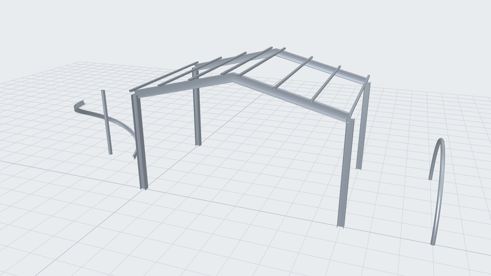

# three-steel

Structural steel sections and beams for three.js: EN and BS profile catalogs, exact section
outlines, and straight, curved and spiral members as closed `BufferGeometry`.



- **293 catalog profiles**: IPE, HEA, HEB, HEM, UPN, UPE, angles, SHS, RHS, CHS, flats and
  rounds (EN 10365 / 10056 / 10219), UB, UC and PFC (BS 4-1).
- **Exact section geometry**: outlines are lines and arcs with root and toe radii, not
  polygons. Tessellate them at whatever tolerance you need.
- **Members on any centerline**: lines, arcs and helices, with an up vector and roll.
- **Angled end cuts and miters** without CSG.
- **No runtime dependencies.** three.js is only needed for the `three-steel/three` adapter.

## Install

```bash
npm install three-steel three
```

## Quick start

```ts
import * as THREE from 'three';
import { createBeamGeometry } from 'three-steel/three';

const geometry = createBeamGeometry({ profile: 'IPE300', start: [0, 0, 0], end: [6000, 0, 0] });
const mesh = new THREE.Mesh(geometry, new THREE.MeshStandardMaterial({ color: 0x8a939d, metalness: 0.6 }));
mesh.rotation.x = -Math.PI / 2; // three-steel is Z-up
mesh.scale.setScalar(0.001); // and in millimetres
scene.add(mesh);
```

## Conventions

- Units are **millimetres**, and **Z is up**. Rotate by −90° about X and scale by 0.001 for a
  Y-up scene in metres.
- A member's local frame: **Z** along the centerline, **Y** the section's up (the web of an I
  section), **X** = Y × Z. The default up is world Z, or a perpendicular for vertical members.
- Section outlines are centred on their bounding box.

## Examples

### Angled ends and miters

```ts
import { Plane3D, Point3D, Vector3D } from 'three-steel';

const apex = new Plane3D(new Point3D(4000, 0, 5000), new Vector3D(1, 0, 0));
createBeamGeometry({ profile: 'IPE300', start: [0, 0, 4000], end: [4000, 0, 5000], endCut: apex });
```

Each end-face vertex slides along the member axis onto the plane, so the cut is exact.

### Curved and spiral members

```ts
import { Arc3D, BeamGeometry, buildCrossSection, getProfile, Helix3D, Point3D, Vector3D } from 'three-steel';
import { beamToBufferGeometry } from 'three-steel/three';

const chs = buildCrossSection(getProfile('CHS139.7x4')!.shape);
const arch = Arc3D.fromThreePoints(new Point3D(0, 0, 0), new Point3D(2500, 0, 2600), new Point3D(5000, 0, 0))!;
beamToBufferGeometry(new BeamGeometry(arch, chs));

// Spiral stair stringer: radius 1300, three quarter turns, 4000 rise per full turn.
const upe = buildCrossSection(getProfile('UPE200')!.shape);
const stringer = new Helix3D(new Point3D(0, 0, 0), Vector3D.Z_AXIS, Vector3D.X_AXIS, 1300, 0, 1.5 * Math.PI, 4000);
beamToBufferGeometry(new BeamGeometry(stringer, upe), { maxDegPerStation: 5 });
```

### Section outlines

```ts
import { buildCrossSection, getProfile, tessellateOutline } from 'three-steel';
import { sectionToShape } from 'three-steel/three';

const section = buildCrossSection(getProfile('HEA200')!.shape);
section.outerCurves; // lines and arcs
tessellateOutline(section.outerCurves, 0.1); // polygon, 0.1 mm chord sag
new THREE.ExtrudeGeometry(sectionToShape(section), { depth: 1000, bevelEnabled: false });
```

## API

### `three-steel`

| | |
|---|---|
| `getProfile(id)`, `ALL_STEEL_PROFILES`, `EU_STEEL_PROFILES`, `UK_STEEL_PROFILES` | Profile catalog |
| `buildCrossSection(shape)` | Section outline (`outerCurves`, `innerContours`, `boundingBox`) |
| `profileMetricsFrom(shape)` | Height, width and thicknesses for any shape |
| `BeamGeometry(centerline, section, up?, rotation?)` | A member: `getCoordinateSystemAt(t)`, `length`, end planes |
| `Line3D`, `Arc3D`, `Helix3D`, `Plane3D`, `Point3D`, `Vector3D`, `CoordinateSystem3D` | Geometry |
| `tessellateOutline(curves, sagMm)`, `polygonArea(points)` | Outline to polygon |
| `computeSweepSpans(beam)` | A curved member as mitered straight chords, for extrude-only kernels |

### `three-steel/three`

| | |
|---|---|
| `createBeamGeometry({ profile, start, end, up?, rotation?, startCut?, endCut? })` | Straight member |
| `beamToBufferGeometry(beam, options?)` | Any `BeamGeometry` |
| `sectionToShape(section, sagMm?)` | `THREE.Shape` with holes |

Options: `sagMm` (outline tolerance, default 0.5), `maxDegPerStation` (curved members, default
7.5), `startCut` / `endCut` (world `Plane3D`), `creaseAngleDeg` (default 30).

The output is non-indexed with per-vertex normals: smooth across fillets and round sections,
sharp at corners. Every mesh is closed and wound outward.

## Development

```bash
pnpm test          # vitest
pnpm example       # the scene in the screenshot, at http://localhost:5173
```

## License

MIT
